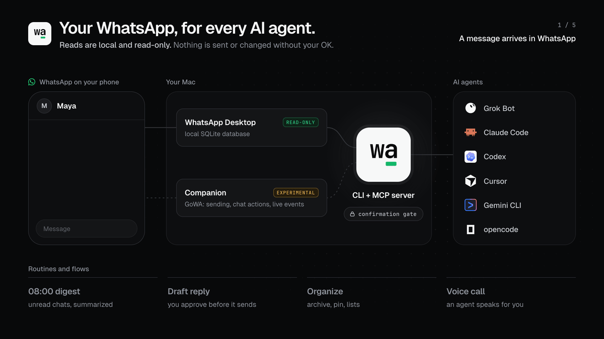

<h1>
  <picture>
    <source media="(prefers-color-scheme: dark)" srcset="docs/img/brand/logo-full-on-dark.svg">
    <source media="(prefers-color-scheme: light)" srcset="docs/img/brand/logo-full-on-light.svg">
    
  </picture>
</h1>

`wa` is a CLI and MCP server that lets an AI agent read your WhatsApp on a Mac and send only what you approve.



It works with Grok Bot, Claude Code, Codex, Cursor, Gemini CLI, opencode and any other MCP client. Once it is connected, you can ask things like:

- "What did I miss in the family group since yesterday?"
- "Find the message where Alex sent the invoice."
- "What does the PDF Alex sent say?" or "Transcribe the last voice note from Mom."
- "Draft a reply to Alex and show it to me." You read the draft, and it goes out only if you say yes.
- "Pin this chat and archive that one."
- "Every morning, summarize my unread chats." Run it on a schedule from your agent; wa does the reading.

There is also an optional voice agent that places a WhatsApp call and talks to the other person to reach a goal you set.

## Install

You need macOS, the WhatsApp Desktop app signed in (the native one, not WhatsApp Web), Python 3.11 or later and [uv](https://docs.astral.sh/uv/).

```sh
git clone https://github.com/jxnxts/whatsapp-mac.git
cd whatsapp-mac
uv tool install .      # puts `wa` and `wa-mcp` in ~/.local/bin
wa --version
```

Then give Full Disk Access to the app that runs `wa` (your terminal, or the agent app), in System Settings > Privacy & Security. Sending also needs Accessibility. Quit and reopen the app afterwards. The [guide](docs/GUIDE.md#2-macos-permissions) has the details.

## Try it

Every command prints JSON. Add `--pretty` to read it yourself.

```sh
wa chats --unread --limit 10 --pretty      # chats with unread messages
wa messages --chat "Alex" --since 2d       # the last two days of one chat
wa search "invoice" --since 30d            # ignores case and accents
```

Sending takes two steps. Without `--confirm` you get a draft and nothing is opened or clicked:

```sh
wa send --to "+1 415 555 0123" --text "Hi!"
WA_ALLOW_SEND=1 wa send --to "+1 415 555 0123" --text "Hi!" --confirm
```

Chat actions and calls follow the same pattern, each with its own switch:

```sh
WA_ALLOW_ACTIONS=1 wa chat-action --to "+1 415 555 0123" --action pin --confirm
WA_ALLOW_CALLS=1 wa call --to "+1 415 555 0123" --confirm
```

To test sending without bothering anyone, send to your own number. WhatsApp shows that chat as "You".

## How it works

- **Reading.** WhatsApp Desktop keeps chats, contacts and call history in SQLite files on your Mac. `wa` opens them read-only and never changes or copies them.
- **Media.** `wa media --message <id>` reads the file of a message: an image the agent can see, the text of a PDF or Office document, OCR, a transcript of a voice note, or frames of a video. `wa send --file` sends a file through the companion. The [guide](docs/GUIDE.md#media) lists what to install.
- **Sending and actions.** By default `wa` drives the WhatsApp app: it opens the chat with your text, presses Return, and then checks the database for the sent message. For a group, pass its jid (`…@g.us`). `wa` opens the chat by jid, pastes the text through the clipboard and then puts your clipboard back. Archive, pin, mute and calls go through the app's menu bar. The app comes to the front for a moment each time. If the Mac screen is locked, `wa` refuses with `screen_locked` and does not touch the app.
- **Companion (experimental).** Optionally, the Mac becomes a linked device, like WhatsApp Web, through [GoWA](https://github.com/aldinokemal/go-whatsapp-web-multidevice). That path sends in the background, sends to groups, replies with a quote, manages chat lists and reads incoming messages in real time. WhatsApp Desktop for Mac does not show your chat lists, so `wa lists` reads them from the companion. Read the caveats before you turn it on.
- **Confirmation.** Anything that changes state needs two things: `--confirm` on the request (`confirm=true` in MCP) and the matching `WA_ALLOW_SEND`, `WA_ALLOW_ACTIONS` or `WA_ALLOW_CALLS` in the environment. All three are off by default. `wa` has no command to block, delete or clear chats.

## Connect an agent

`wa-mcp` is the same tool as an MCP server over stdio. Use the absolute path (`which wa-mcp`). For Claude Code:

```sh
claude mcp add --scope user whatsapp -- "$HOME/.local/bin/wa-mcp"
```

For clients configured with JSON, such as Claude Desktop and Cursor:

```json
{
  "mcpServers": {
    "whatsapp": {
      "command": "/Users/YOUR_USER/.local/bin/wa-mcp",
      "args": [],
      "env": {}
    }
  }
}
```

With an empty `env` the server can only read. Add `"WA_ALLOW_SEND": "1"` to let the agent send, and it still has to pass `confirm=true` each time. The guide lists [where each client keeps its config](docs/GUIDE.md#7-register-the-server-in-an-agent).

## Caveats

- **Not affiliated.** This project is not affiliated with, authorized or endorsed by WhatsApp or Meta. You are responsible for how you use it, including the [WhatsApp Terms of Service](https://www.whatsapp.com/legal/terms-of-service), data protection laws such as the GDPR or the LGPD, and the privacy of the people you talk to.
- **Your chats reach your model provider.** Whatever the agent reads is sent to the provider of the model you use. `wa` itself has no telemetry, and reading or sending through the app opens no network connection of its own.
- **Media stays local until the agent gets it.** OCR (macOS Vision) and transcription (mlx-whisper or whisper.cpp) run on your Mac. The OpenAI API transcribes only if you turn it on. The text, images and video frames that `wa` hands to the agent go to your model provider like any other message.
- **Messages are untrusted input.** Anyone who writes to you controls part of what the model reads. The tool descriptions tell the model to treat message text as data, which does not stop prompt injection. Keep the switches off and read the draft before you confirm.
- **The companion is an unofficial client.** WhatsApp does not allow it and can suspend or ban your number without warning. Use a test number if you can, and never send in bulk. Its session folder, `~/.local/share/wa-mac/gowa/storages/`, gives full access to your account until you unlink the device on your phone, so keep it out of backups, repositories and other computers.
- **The voice agent speaks to other people for you.** It introduces itself as an assistant and never claims to be you. The call audio goes through OpenAI. Tell the other person when you can.
- **macOS only, and language matters for some features.** Chat actions and calls find menu items by title. Brazilian Portuguese is tested. The English titles come from the app's localization files and are untested. In other languages those commands stop with `action_failed`. Reading and sending text work in any language.
- **What has run on a real account.** Reading, sending to a person through the app, archive and pin (Portuguese UI), companion pairing, chat actions through the companion (archive, unarchive, pin, mute, unmute, mark unread), chat lists through the companion (create, add a chat, remove it, delete), reading media (image OCR, PDF text, voice note transcripts) and sending an image, a document and a voice note through the companion. Unpin through the companion is not confirmed. Sending to a group through the app, the locked-screen check, calls, mute through the app, the voice agent, text sending and the inbox through the companion, and media from videos and files fetched through the companion have only run against simulators.
- **No warranty.** `wa` clicks menus in a third-party app and reads a database schema that is not documented. It was tested with WhatsApp for Mac 26.46, and any release can break it.

## More

- [docs/GUIDE.md](docs/GUIDE.md) is the full reference: every command and error code, permissions, the voice agent and the companion.
- [docs/DEVELOPMENT.md](docs/DEVELOPMENT.md) covers the tests, the source layout and notes on the WhatsApp database.

## License

[MIT](LICENSE) © Jonatas Soares.

The `wa` logo in `docs/img/brand/` belongs to this project and is under the same license. WhatsApp and the other product names and logos shown in this repository, including those in the animation, are trademarks of their owners and appear only to show compatibility.
